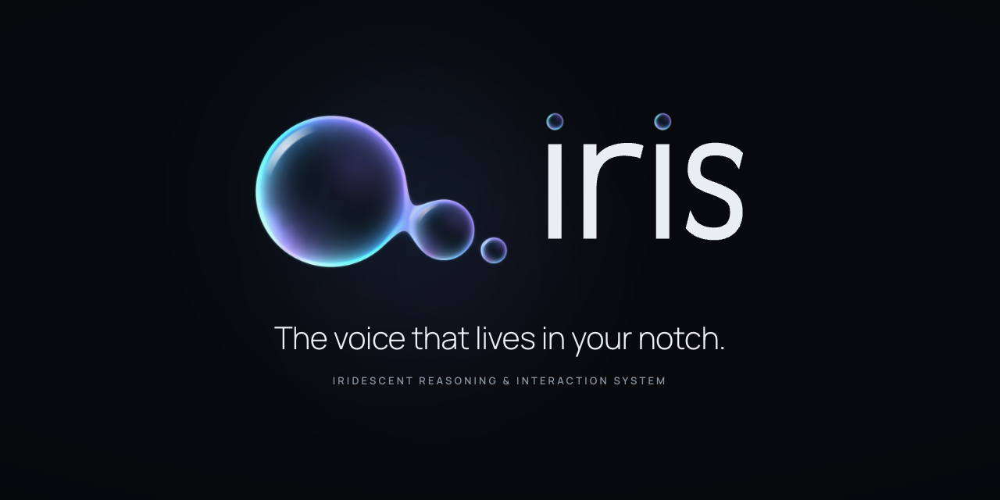
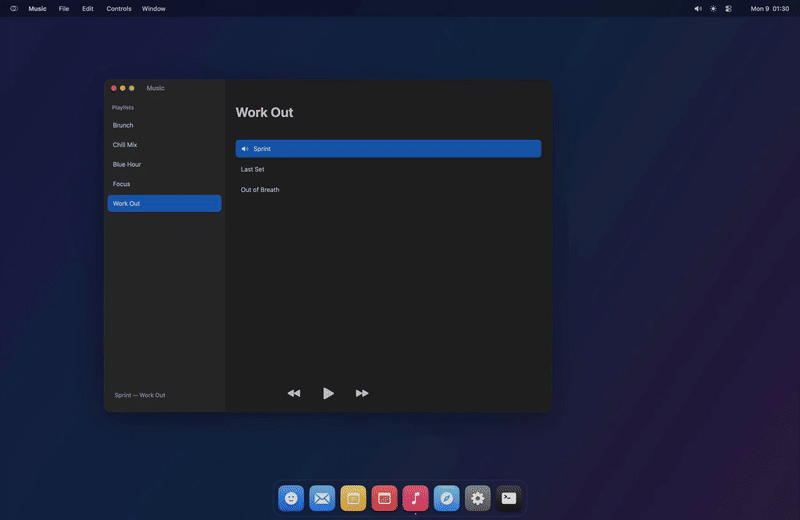
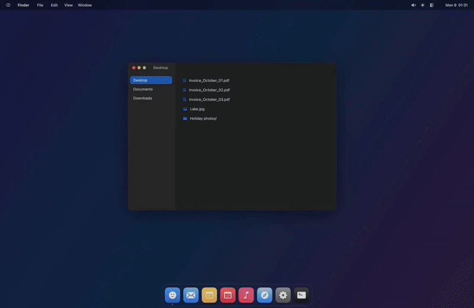
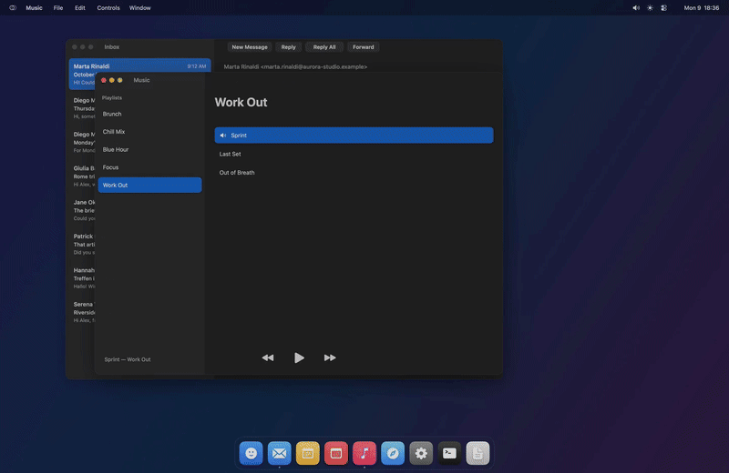

  <picture>
    <source media="(prefers-color-scheme: light)" srcset=".github/assets/readme-banner-light.png">
    
  </picture>

  <b>The voice assistant for your Mac.</b> 
  You say what you want, and Iris does it on your Mac.

  <a href="https://github.com/irismac/iris/releases/latest"><b>Download the beta</b></a> ·
  <a href="https://irismac.com">irismac.com</a> ·
  <a href="https://www.youtube.com/@irismacapp">YouTube</a> ·
  <a href="https://www.instagram.com/irismacapp">Instagram</a> ·
  <a href="https://x.com/irismacapp">X</a>

  
  
  
  

---

## Say it, and it's done

Iris lives in your Mac's notch. Say «Iris», or hold <kbd>⌥</kbd> <kbd>Space</kbd>, and ask. It opens, finds, writes, files and sets things up across your apps, and shows you what it's doing as it goes.

<table>
  <tr>
    <td width="50%" valign="top">
       
      <b>Quick commands, done on the Mac.</b> Volume, dark mode, quitting an app: simple commands run locally, without the AI.
    </td>
    <td width="50%" valign="top">
       
      <b>Your files, by name.</b> «Open my October invoices»: Iris finds them and opens them. <i>(Sped up 2×.)</i>
    </td>
  </tr>
  <tr>
    <td colspan="2" valign="top">
       
      <b>Routines.</b> «Work mode» closes what distracts you, opens Terminal with Claude Code and your inbox beside it, all in one sentence.
    </td>
  </tr>
</table>

Real recordings of Iris on a demo Mac with example data.

## What it does

- **Voice, wake word or a key.** «Iris…», or hold <kbd>⌥</kbd> <kbd>Space</kbd>. <kbd>⌥</kbd> <kbd>Esc</kbd> stops everything at once.
- **Acts on your Mac.** Apps, files, folders, settings, menus, the web. It prefers each app's own way in, and uses the screen and mouse only as a last resort.
- **Dictation anywhere.** Hold <kbd>fn</kbd> and speak into any text field; Iris cleans up the words.
- **Hands-free mode.** Run your Mac by voice: windows, menus, buttons, typing.
- **Routines and alerts.** «When I say *work mode*, do…», «Let me know when…».
- **Asks before it matters.** Anything destructive waits for your yes, payments and passwords always do, and a blocklist keeps apps you choose out of reach.
- **Speaks English and Italian.** Its voice runs on your Mac.

## The AI is yours

Iris has no AI account and no servers of its own. For anything beyond simple Mac commands it uses **[Claude Code](https://claude.com/claude-code)**, installed and signed in on your Mac with your own plan. Without it, Iris still does the quick commands, dictation, routines and alerts on its own.

## Install the beta

1. Download **`Iris.dmg`** from the [latest release](https://github.com/irismac/iris/releases/latest), open it and drag **Iris** into **Applications**.
2. Open Iris from Applications. This beta isn't notarized yet, so the first time macOS blocks it: go to **System Settings › Privacy & Security** and choose **Open Anyway**.
3. Follow the first run: microphone and the other permissions, then Iris downloads its voice and wake-word models (about 2.5 GB, once).

The beta is free. This beta build works until **31 December 2026**, when the released version takes over. Requires macOS 26 or later on a Mac with Apple silicon.

## Feedback

Found a bug or have an idea? [Open an issue](https://github.com/irismac/iris/issues), or choose **Send Beta Report…** in Iris's menu. Each report is a mail you read and send yourself.

## This repository

For now it holds the beta releases and the issues. The source code is not published yet.

---

© 2026 Paolo Vezzini. All rights reserved. The beta is licensed under the <a href="https://irismac.com/terms.html">terms at irismac.com</a>; privacy: <a href="https://irismac.com/privacy.html">irismac.com/privacy</a>. The name «Iris», its logo and the look of its orb are reserved. Claude and Claude Code are trademarks of Anthropic; Iris is an independent project.
